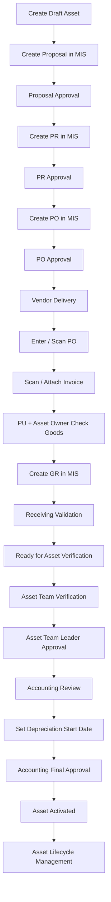
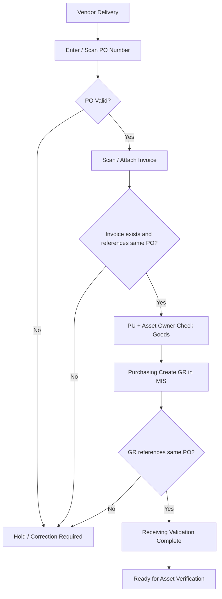
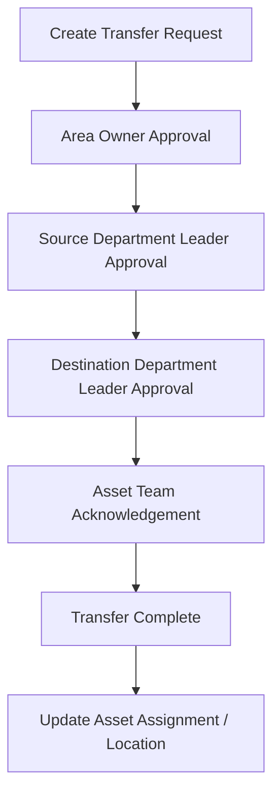

# AGENTS.md — TBKK Asset Management Mockup

## 1. Purpose of this file

This file is the working product context for Codex when creating or modifying **mockups for the TBKK Asset Management System**.

The goal is to build a realistic internal enterprise web application mockup that demonstrates the full Asset process from initial asset request through acquisition, receiving, verification, activation, and lifecycle management.

When implementing mockups:

- Treat this file as the primary product context.
- Preserve the current Asset Workspace visual language if an existing mockup/project already exists.
- Do not invent business rules that conflict with this document.
- When a rule is marked **OPEN / TO CONFIRM**, design the UI so it remains flexible instead of hard-coding one interpretation.
- This project is currently focused on **UI/UX mockups and process validation**, not production backend integration.

---

# 2. Product overview

The Asset Management System is an internal TBKK web application for managing company assets across two major phases:

1. **Asset Acquisition & Activation**
   - Create Draft Asset
   - Proposal
   - PR
   - PO
   - Vendor Delivery
   - Invoice / GR validation
   - Asset Team Verification
   - Asset approval
   - Accounting review
   - Asset Activation

2. **Asset Lifecycle Management**
   - Add Sub Asset
   - Modification
   - Maintenance
   - Transfer
   - Spare Part Usage History
   - Future: Disposal / Write-off

The Asset system is not responsible for every purchasing transaction. It integrates with an existing external web application called **MIS**.

---

# 3. External system boundary — MIS

**MIS is a separate web application.**

MIS is responsible for purchasing-related transactions such as:

- Proposal
- Purchase Requisition (PR)
- Purchase Order (PO)
- Goods Receipt (GR)
- Spare Part issue / withdrawal

The Asset Management System should reference and display the related MIS information but should not duplicate MIS purchasing workflows unless the mockup explicitly needs to show the handoff.

In UI text, use labels such as:

- `Create Proposal (MIS)`
- `Create PR (MIS)`
- `Create PO (MIS)`
- `Create GR in MIS`

---

# 4. Main actors

## Requestor / Asset Owner

- Creates or requests a new Asset.
- Provides initial Asset information.
- Participates in checking delivered goods.
- May be the current owner/custodian of the Asset.

## MIS User

- Creates Proposal, PR, PO, and GR in MIS.

## MIS Approver

- Approves Proposal, PR, and PO according to the MIS workflow.

## Purchasing / PU

- Coordinates purchasing activities.
- Checks delivered goods with the Asset Owner.
- Creates GR in MIS.

## Vendor

- Delivers goods.
- Provides Invoice / delivery documents.

## Asset Team

- Maintains Asset records.
- Reviews receiving references.
- Verifies the actual Asset against approved/requested information.
- Submits verified Assets for approval.
- Maintains lifecycle information.

## Asset Team Leader

- Reviews and approves Asset records after Asset Team verification.

## Accounting

- Reviews Asset information.
- Defines the Depreciation Start Date.
- Performs final approval before Asset Activation.

## Area Owner

- First approver in the Asset Transfer workflow.

## Source Department Leader

- Approves an Asset leaving the source department.

## Destination Department Leader

- Approves an Asset entering the destination department.

---

# 5. Core Asset fields

The initial Asset creation form must include these fields:

- Asset Name
- Asset Class
- Model
- Custodian
- Plant
- Location
- Line
- Power
- Area
- Target SOP

New Assets start with status:

`Draft`

Draft Assets can be edited until they enter the controlled acquisition process.

---

# 6. High-level end-to-end process



---

# 7. Asset acquisition process

## 7.1 Create Draft Asset

The Requestor creates an Asset in the Asset system using the core Asset fields.

Expected behavior:

- Default status = `Draft`
- User can save and edit Draft data.
- Asset receives a unique temporary/reference number.
- Draft Assets become selectable during Proposal creation in MIS.

## 7.2 Proposal

In MIS, the user creates a Proposal and selects one or more Draft Assets.

A Proposal may contain multiple Assets.

Each selected Asset can have additional costs inside that Asset scope, for example:

- Asset Amount
- Installation Cost
- Delivery Cost
- Other Cost

These additional costs belong to the selected Asset, not to the Proposal as unassigned global costs.

Example:

```text
Proposal PROP-001

Asset A
- Asset Amount: 500,000
- Installation: 30,000
- Delivery: 10,000

Asset B
- Asset Amount: 200,000
- Installation: 20,000
```

## 7.3 Proposal → PR → PO

After Proposal approval:

```text
Proposal Approved
→ Create PR
→ PR Approval
→ Create PO
→ PO Approval
```

A single Proposal may result in multiple POs.

### IMPORTANT — PO / Asset relationship

The exact final business cardinality is **OPEN / TO CONFIRM**.

Known facts:

- One Proposal can have multiple POs.
- One PO can have multiple Invoices.
- A PO is a purchasing document and can contain multiple PO lines/items in normal purchasing concepts.

Do **not** hard-code the UI around the assumption `1 PO = 1 Asset` unless a later requirement explicitly confirms this.

For flexible mockups, prefer showing an Asset linked to a relevant **PO / PO Item** reference.

Recommended conceptual model:

```text
Proposal
  └─ Proposal Asset
       └─ PO / PO Item
            ├─ Invoice(s)
            └─ GR record(s)
```

---

# 8. Receiving Validation process

Receiving Validation happens after PO approval and Vendor delivery.

## 8.1 Process



## 8.2 PO validation

At minimum:

- PO exists.
- PO is valid for receiving.

If invalid:

`Hold / Correction Required`

## 8.3 Invoice validation

Invoice validation is intentionally lightweight.

Validate only:

- Invoice document exists.
- Invoice references the same PO.

Do **not** use Invoice amount or Invoice quantity as the receiving validation criterion.

The system is **not** performing accounting 3-way matching.

A PO may have more than one Invoice.

Example:

```text
PO-001
├─ Invoice-001
├─ Invoice-002
└─ Invoice-003
```

## 8.4 Physical receiving

PU + Asset Owner physically verify delivered goods.

After the check, Purchasing creates GR in MIS.

## 8.5 GR validation

Validate:

- GR exists.
- GR references the same PO.

When the required PO, Invoice, and GR references are valid:

`Receiving Validation Complete`

then:

`Ready for Asset Verification`

---

# 9. Asset Team Verification

Asset Team Verification must be **Asset-centric**, not PO-centric.

Receiving Validation already handles purchasing document reference checks.

Asset Team Verification answers:

> Is the received item correctly identified as the Asset that was requested/approved, and is the Asset information ready for approval and activation?

## 9.1 Recommended page structure

### A. Asset Header

Show:

- Asset No.
- Asset Name
- Current Status
- Proposal No.
- PO / PO Item reference
- GR No.

Status example:

`Ready for Verification`

### B. Receiving Validation Summary

Show a compact summary only:

- PO Status: Valid
- Invoice Document(s): Available / Valid
- GR Reference: Valid
- Ordered Qty / Received Qty
- Receiving Status: Complete

Do not repeat deep PO/Invoice/GR validation here.

If financial amounts are shown, label them as **reference only**, not as a verification pass/fail condition.

### C. Asset Information

Show:

- Asset Name
- Asset Class
- Model
- Custodian
- Plant
- Location
- Line
- Power
- Area
- Target SOP

### D. Verification Information

Editable by Asset Team:

- Confirmed / Estimated SOP
- Comment / Remark
- Verification Result
  - Complete
  - Mismatch

### E. Verification Checklist

Recommended checklist:

- Asset identity confirmed
- Asset class confirmed
- Model confirmed
- Custodian confirmed
- Location confirmed
- Required Asset information complete

Do not repeat full PO/Invoice/GR checking here.

### F. Actions

- `Return for Correction`
- `Submit for Approval`

Submit should only be enabled when:

- Receiving Validation = Complete
- Asset Verification Result = Complete
- Required Asset information is complete

## 9.2 Suggested desktop layout

Two-column layout:

**Left**
- Receiving Validation Summary
- Asset Information

**Right**
- Verification Information
- Verification Checklist

Bottom action bar:

- Return for Correction
- Submit for Approval

---

# 10. Asset approval and activation

After Asset Team submits verification:

```text
Asset Team
→ Asset Team Leader
→ Accounting Review
→ Set Depreciation Start Date
→ Accounting Final Approval
→ Asset Active
```

## Asset Team Leader

Actions:

- Approve
- Return for Correction

## Accounting

Responsibilities:

- Review Asset and acquisition information.
- Set Depreciation Start Date.
- Final approval.

Depreciation display rule:

- Useful Life is maintained on the Asset Type.
- Monthly Depreciation = Asset Value ÷ Useful Life (years) ÷ 12.
- Display the calculated monthly amount on the Asset detail DP tab.
- Accumulated Depreciation = Monthly Depreciation × depreciation periods, capped at Asset Value.
- Net Book Value = Asset Value − Accumulated Depreciation.
- Mockup period convention: count the start month as the first full period and calculate through the current month; do not prorate partial months or model residual value / impairment.

After final Accounting approval:

`Asset Status = Active`

The Asset can then enter lifecycle processes.

---

# 11. Asset Lifecycle Management

Lifecycle processes are independent events after the Asset becomes Active.

Do not display them as one mandatory sequential flow.

```text
Active Asset
├─ Add Sub Asset
├─ Modification
├─ Maintenance
├─ Transfer
└─ Spare Part Usage
```

---

# 12. Add Sub Asset

A Sub Asset is an Asset/component associated with a Parent Asset.

Concept:

```text
Parent Asset
└─ Sub Asset
```

The creation process is conceptually similar to creating/acquiring a new Asset.

Recommended flow:

```text
Select Parent Asset
→ Create Sub Asset Request
→ Enter Sub Asset Information
→ Acquisition / Approval Process as applicable
→ Complete
→ Link Sub Asset to Parent Asset
```

The UI must clearly show:

- Parent Asset
- Sub Asset
- Relationship
- Added value / expense treatment
- History

## Capitalization rule

For **Sub Asset**:

- Value **> 50,000 THB** → increase Asset value / capitalization.
- Value **<= 50,000 THB** → expense.

Important: the current confirmed wording is **greater than 50,000**, not greater than or equal to 50,000.

---

# 13. Modification

Modification is used when an existing Asset is changed, upgraded, or enhanced.

Examples:

- Machine upgrade
- Additional equipment
- Capability improvement
- Safety modification

Recommended flow:

```text
Select Active Asset
→ Create Modification Request
→ Enter Modification Details
→ Acquisition / Approval Process as applicable
→ Modification Complete
→ Store Modification History
```

## Capitalization rule

For **Modification**:

- Value **> 50,000 THB** → increase Asset value / capitalization.
- Value **<= 50,000 THB** → expense.

The UI should clearly display whether a transaction is classified as:

- `Capitalized`
- `Expense`

based on the threshold.

---

# 14. Maintenance

Maintenance records repair or maintenance activities for an Active Asset.

Conceptual flow:

```text
Select Asset
→ Create Maintenance Request
→ Enter Maintenance Information
→ Perform Maintenance
→ Record Result / Cost
→ Complete Maintenance
→ Store Maintenance History
```

Recommended information:

- Maintenance Type
- Problem / Description
- Date
- Vendor / Responsible Team
- Cost
- Result
- Attachments
- Status

Maintenance does not automatically increase Asset value.

Keep maintenance history visible on the Asset detail page.

---

# 15. Asset Transfer

Transfer has a specific approval workflow different from the other lifecycle processes.

## Transfer approval flow



After completion, update the applicable Asset data such as:

- Custodian / Owner
- Department
- Plant
- Location
- Line / Area where applicable

Keep full transfer history.

Never overwrite history without retaining the original source values.

A Transfer detail should make `From` and `To` very clear.

Example:

```text
FROM
Department A
Owner A
Location A

TO
Department B
Owner B
Location B
```

---

# 16. Spare Part Usage

Spare Part inventory and issue processing belong to MIS, not to the Asset system.

Process:

```text
User issues Spare Part in MIS
→ User selects which Asset the Spare Part is used for
→ MIS completes Spare Part transaction
→ Asset system receives/stores the reference
→ Asset system displays Spare Part Usage History and Cost
```

Asset System responsibility:

- Show spare parts used for the Asset.
- Show quantity.
- Show cost.
- Show issue date/reference.
- Maintain usage history.

Asset System is **not** responsible for:

- Spare Part stock balance
- Warehouse inventory
- Stock issue approval
- Inventory replenishment

Recommended Asset detail history table:

| Date | Spare Part | Qty | Cost | MIS Reference |
|---|---|---:|---:|---|

---

# 17. Future lifecycle process — Disposal / Write-off

Disposal / Write-off has been identified as a logical future end-of-life process but its detailed requirements are **not yet confirmed**.

Do not invent the approval workflow yet.

It may be shown as `Future` or omitted from mockups unless specifically requested.

---

# 18. Recommended Asset statuses

These are useful UI statuses. Adjust only if the existing project already has an approved status model.

## Acquisition / Activation

- Draft
- Proposal Processing
- Purchasing
- Waiting Delivery
- Waiting Invoice
- Waiting GR
- Receiving Validation
- Ready for Verification
- Verification In Progress
- Pending Asset Team Leader Approval
- Pending Accounting Review
- Pending Accounting Approval
- Active
- Returned for Correction
- On Hold

## Lifecycle transaction statuses

Use a simple pattern where applicable:

- Draft
- Pending Approval
- Returned
- Approved
- Completed
- Cancelled

Do not overload the Asset master status with every temporary lifecycle transaction status. Prefer separate transaction status for Modification, Maintenance, Transfer, etc.

---

# 19. Recommended information architecture / pages

Codex should create coherent navigation for at least the following areas.

## Dashboard

Possible content:

- Total Assets
- Active Assets
- Draft / Acquisition Assets
- Waiting Verification
- Pending Approval
- Lifecycle activity summary
- Recent transactions

## Asset List

Must support:

- Search
- Filter
- Status
- Asset Class
- Plant
- Location
- Custodian
- Actions

## Create Asset

Fields:

- Asset Name
- Asset Class
- Model
- Custodian
- Plant
- Location
- Line
- Power
- Area
- Target SOP

Actions:

- Cancel
- Save Draft

## Asset Detail

Recommended tabs/sections:

- Overview
- Acquisition
- Approval History
- Sub Assets
- Modifications
- Maintenance
- Transfers
- Spare Parts
- History / Timeline

## Receiving / Verification

- Ready for Verification List
- Asset Team Verification Detail
- Receiving Validation Summary

## Approval

- Asset Team Leader Approval
- Accounting Review
- Approval History

## Lifecycle

- Add Sub Asset
- Modification
- Maintenance
- Transfer
- Spare Part Usage History

---

# 20. Mockup design direction

Use the current Asset Workspace style shown in the existing mockups as the visual baseline.

## Overall style

- Clean internal enterprise application
- White background
- Blue primary color
- Dark navy text
- Thin light-gray / blue borders
- Rounded cards
- Subtle shadows
- Spacious layout
- Strong information hierarchy
- Minimal decoration
- Professional manufacturing / enterprise feel

## Existing shell

Preserve when available:

- Blue vertical left sidebar
- Top application header
- Search field in top bar
- Notifications / user profile area
- Page breadcrumb
- Large page title
- Status badge near title
- Card-based content
- Bottom action bar for transaction pages

## Forms

- Use labels above controls.
- Group fields by business meaning.
- Avoid extremely long single-column forms on desktop.
- Use 2-column or 3-column grids where appropriate.
- Required fields must be clear.
- Use read-only states clearly for approved/reference data.

## Tables

- Compact but readable.
- Sticky or clear headers for long tables.
- Use status badges.
- Keep financial information right-aligned.
- Avoid combining different business document types in one ambiguous column.

Example: do not label a table `Invoice / GR Records` if Invoices and GRs are different records. Show separate `Invoices` and `Goods Receipts` sections.

## Status colors

Use semantic colors carefully:

- Blue = informational / in progress
- Green = valid / completed / active
- Amber = waiting / attention
- Red = mismatch / rejected / correction required
- Gray = inactive / unavailable

Do not overuse strong colors.

---

# 21. Important UX rules

1. **Asset-centric design**
   - The Asset should remain the main context after acquisition starts.
   - PO, Invoice, GR, Proposal are references around the Asset.

2. **Do not duplicate Receiving Validation inside Asset Verification**
   - Receiving page checks document references.
   - Asset Team page verifies the Asset itself.

3. **Separate Invoice and GR visually**
   - They have different meanings and may have different counts.

4. **One PO may have multiple Invoices**
   - UI must support 0..N Invoice records.

5. **Proposal may contain multiple Assets**
   - Proposal UI must support selecting more than one Draft Asset.

6. **Additional costs belong under each selected Asset**
   - Installation, delivery, and other costs are scoped to that Asset.

7. **Lifecycle history must remain visible**
   - Never design lifecycle actions as if they overwrite all previous state/history.

8. **Approval history should be inspectable**
   - Actor
   - Action
   - Date/time
   - Remark
   - Status/result

9. **Do not imply Invoice financial reconciliation**
   - Invoice amount can be shown as reference if useful.
   - Amount equality is not a pass/fail criterion in current requirements.

10. **Do not hard-code unresolved PO cardinality**
    - Keep UI and mock data flexible for PO / PO Item relationships.

---

# 22. Suggested mock data

Use realistic internal mock data. Example:

```text
Asset No: ME-2026-0005
Asset Name: Transfer Conveyor
Asset Class: ME - Machine
Model: TC-8800
Custodian: Maya Singh
Plant: Plant 1
Location: Line C
Line: Line C
Power: 380 VAC, 50 Hz
Area: Assembly
Target SOP: 22 Oct 2026
Status: Ready for Verification

Proposal: PROP-2026-0012
PR: PR-2026-0013
PO: PO-2026-0097
Vendor: Daifuku (Thailand) Ltd.

Invoices:
- INV-DF-260422
- INV-DF-260430

GR:
- GR-0002
```

Amounts can be used as realistic reference values but must not imply financial matching unless explicitly requested.

---

# 23. Recommended mockup sequence for Codex

When asked to mock the whole application, implement in this order:

1. App Shell / Navigation
2. Dashboard
3. Asset List
4. Create Asset
5. Asset Detail
6. Proposal Asset Selection concept
7. Receiving Validation flow / status
8. Asset Verification List
9. Asset Team Verification Detail
10. Asset Team Leader Approval
11. Accounting Review / Activation
12. Add Sub Asset
13. Modification
14. Maintenance
15. Transfer
16. Spare Part Usage History
17. Unified Asset History / Timeline

Prioritize flow consistency over visual novelty.

---

# 24. Mockup implementation rules for Codex

- Reuse existing components before creating new ones.
- Reuse the existing layout/sidebar/header if present.
- Keep naming consistent across pages.
- Keep mock data centralized if possible.
- Do not create backend APIs unless requested.
- For mockups, use local/static mock data.
- Actions should feel interactive even when no backend exists:
  - tabs
  - filters
  - modal dialogs
  - status transitions
  - confirmation dialogs
  - collapsible sections
- Avoid dead UI controls where possible.
- Build desktop-first, but keep the layout reasonably responsive.
- Do not redesign unrelated application shell components unless requested.

If the repo has an existing `design.md` or digital design system file, **read and follow it before changing UI**. The existing Asset Workspace screenshots and components take precedence over generic design preferences.

---

# 25. Known open questions / do not assume

The following are not fully confirmed and should remain flexible:

1. Exact **PO ↔ PO Item ↔ Asset** cardinality.
2. Whether one PO may have multiple GRs due to partial deliveries.
3. Exact approval chain for Add Sub Asset.
4. Exact approval chain for Modification.
5. Exact approval chain for Maintenance.
6. Whether Maintenance ever becomes capitalization under special accounting rules.
7. Detailed Disposal / Write-off workflow.
8. Exact source/API mechanism used to sync MIS Proposal/PR/PO/GR data into Asset System.

When a mockup touches one of these areas, choose a flexible UX and label data clearly rather than inventing a final rule.

---

# 26. Current confirmed accounting rule

For **Modification** and **Sub Asset** transactions:

```text
Value > 50,000 THB
→ Capitalization / Increase Asset Value

Value <= 50,000 THB
→ Expense
```

Make this classification clearly visible in relevant mockups.

---

# 27. Product principle

The core product concept is:

> **One Asset record should provide a complete digital history from request and acquisition through receiving, verification, activation, and every lifecycle event.**

A user opening an Asset should eventually be able to understand:

- Why it was requested
- Which Proposal / PR / PO acquired it
- Which Invoice / GR references were involved
- Who verified and approved it
- When depreciation started
- Where the Asset is now
- Who owns/custodies it
- What Sub Assets were added
- What Modifications were made
- What Maintenance was performed
- Where it has been transferred
- Which Spare Parts were consumed
- What costs were associated with its lifecycle

All mockups should support this concept.

# 28. Confirmed Proposal-driven existing-asset work (1 Oct 2026)

This update supersedes the earlier standalone creation flows and accounting guidance for Add Sub Asset, Modification and Maintenance.

- Begin in **Create Proposal (MIS)**. Each Proposal item selects **New Asset** (an available Draft Asset) or **Existing Asset** (an Active Asset).
- Existing Asset items select an Asset and a work type: **Addition Sub-Asset**, **Modification**, or **Maintenance**. The work type describes the origin and remains visible in history.
- Classify each existing-asset item's total (base amount plus its scoped additional costs): **> 50,000 THB** creates a capitalized Sub Asset; **<= 50,000 THB** is Expense and creates no Asset record. This applies to all three work types.
- Asset hierarchy has exactly two levels: Main Asset → Sub Asset. Existing-asset work may select either an Active Main Asset or an Active Sub Asset. A capitalized transaction on a Sub Asset creates a sibling directly under the Main Asset, using its next suffix (never `-1-1`). Preserve the selected work target as `sourceAssetId`, separate from the new record’s `parentAssetId`. Expense stays on the selected Asset. Main Asset history also displays work on its Sub Assets.
- Create the Sub Asset when **Save Proposal** succeeds, before Proposal approval. Its number is the Parent Asset number followed by the next unused sequential suffix: `-1`, `-2`, `-3`, etc. Do not reuse previous suffixes.
- The Sub Asset starts in **Proposal Processing** and follows the existing new-asset flow through Proposal approval, PR, PO, receiving, verification, Asset Team Leader and Accounting approval, then Active.
- Copy the selected work target’s classification and assignment to the new record. Collect the new component name/model/power/Target SOP. Do not copy Parent purchasing documents, approval history or depreciation dates into the child.
- Keep the Parent Active. The child has its own acquisition value and depreciation; Expense PO items must not increase Parent depreciation value.
- Keep Parent/child relationships, original work type and Proposal/PR/PO/GR references inspectable in Asset history. Asset Detail is a history/relationship surface; it must not offer standalone creation for these three types. Transfer retains its existing workflow.
- Expense flow: Proposal → PR → PO → Invoice → GR Received → Completed. Complete automatically on GR save when PO/Invoice/GR references are valid for the same PO and Purchasing + Asset Owner confirm delivery or completed work. Partial receiving remains GR Received; invalid references or failed acceptance require Hold / Correction Required. Invoice amounts are not a validation criterion. Record cost, completion date, original work type and document references in Parent history. Expense never creates a child, increases Asset value, or enters activation.


# 29. Confirmed Customer Assets (6 Oct 2026)

- Create/Edit Draft Asset includes ownership: Company Asset (TBKK) or Customer Asset. Customer Assets require the customer's name on the Asset record.
- Existing records without an ownership field are Company Assets.
- Choose ownership once at the start of Create Proposal (MIS). Show only Assets of that ownership; a Proposal cannot mix Company and Customer Assets.
- Customer Proposals select available Customer Draft Assets only. Existing-asset work is a lifecycle event and is unavailable for Customer Assets.
- Customer Assets follow the existing acquisition, receiving, verification, Asset Team Leader and Accounting approval steps through Active. Keep document references and approval history.
- Customer Assets have no depreciation, no depreciation start date requirement and no DP editing or calculations.
- Customer Assets have no lifecycle events: Addition Sub-Asset, Modification, Maintenance, Transfer or Spare Part Usage. Exclude them from Movement selection and simulated MIS spare part issues.


# 30. Sale Disposal mockup (12 Oct 2026)

- Confirmed overall flow: Create Sale Proposal → Proposal Approved → Issue Tax Invoice via e-Tax → Verify Sale → Derecognize Asset → Sold → Stop Depreciation → Keep Disposal History.
- Current mockup begins **after Verify Sale**; earlier steps are document references, not new purchasing or e-Tax workflows.
- Derecognize the selected Active Company Asset, set Sold, stop depreciation and preserve its original acquisition, assignment, approval and lifecycle history. Customer Assets remain excluded from lifecycle events.
- Record buyer, approved Sale Proposal reference, e-Tax invoice reference, verifier, sale/derecognition date, optional sale amount, remark, actor and completion timestamp. Preserve a financial snapshot at disposal.
- The final depreciation month convention is **OPEN / TO CONFIRM**. The mockup requires an explicit choice to include the sale month as a full period or stop in the prior month. No daily proration.
- Parent/Sub Asset sale scope is **OPEN / TO CONFIRM**. The mockup processes only the selected Asset, preserves hierarchy and shows remaining Sub Assets; it does not automatically sell children.
- Sold records remain inspectable in Asset Detail and Disposal history. DP details are read-only after sale. Reports retain pre-sale months, show disposal cost/DP removal and zero closing carrying balance in the sale month, and exclude the Asset in later months.
