# TBKK Asset Management — Swimlanes

Reviewed 8 October 2026 against the current React mockup and AGENTS.md sections 28–29. These diagrams describe the **confirmed business process**. The implementation differences are listed in [ER notes](./asset-management-er-notes.md#จุดต่างระหว่างโค้ดและ-requirement); the diagrams do not imply those differences have been fixed in application code.

Each named lane identifies the responsible actor and system. Solid arrows show handoffs or decisions; correction arrows return work to the responsible actor. Mermaid automatically lays out cross-lane connections, so these are responsibility swimlanes rather than strict BPMN diagrams. The separate flows keep independent lifecycle events out of the mandatory acquisition sequence.

| Diagram | Scope | Editable source |
| --- | --- | --- |
| Acquisition and activation | Company / Customer Draft through MIS purchasing, receiving, Asset verification, approval and Active | [asset-management-swimlane.mmd](./asset-management-swimlane.mmd) |
| Existing-asset work | Proposal-driven Addition Sub-Asset / Modification / Maintenance; capitalized child versus Expense | [asset-management-swimlane-existing-work.mmd](./asset-management-swimlane-existing-work.mmd) |
| Independent lifecycle events | Four-stage Transfer approval and external MIS Spare Part Usage | [asset-management-swimlane-lifecycle.mmd](./asset-management-swimlane-lifecycle.mmd) |

## Reading rules

- MIS owns Proposal, PR, PO, GR and spare part issue workflows. The mockup simulates these screens locally; no production MIS integration is implemented.
- Choose Proposal ownership once. A Proposal cannot mix Company and Customer Assets. Customer selects only available Customer Drafts, requires customerName, follows acquisition approval, and has no DP or lifecycle events.
- A Proposal supports multiple Asset items in the confirmed model; costs belong to each item. Current Proposal UI selects one Asset and filters by projectCode. PO / PO Item / Asset cardinality remains OPEN / TO CONFIRM.
- Existing Company work may target an Active Main or Sub Asset. For all three work types, total = base amount + item costs: **> THB 50,000 creates a capitalized Sub Asset on successful Proposal save; <= THB 50,000 is Expense with no Asset record**. Save happens before Proposal approval. A capitalized child targeting a Sub Asset becomes a sibling under Main, with sourceAssetId kept separately from parentAssetId. Never reuse a suffix.
- Receiving validates PO eligibility, Invoice document existence and same-PO reference, acceptance by PU + Asset Owner, and GR existence / same-PO reference. **Invoice amount and Invoice quantity are not pass/fail criteria**. PO has 0..N Invoices; invoice amount equality in the current Vendor Delivery mockup is a documented discrepancy.
- Expense completes automatically on valid GR save only when required goods/work are fully accepted. Partial receiving stays GR Received; invalid references or failed acceptance require Hold / Correction Required. Cumulative receipts are implemented, but the final multiple-GR policy and allocation of receipts across Assets remain unconfirmed.
- Acquisition verification remains Asset-centric. Submit requires complete receiving, verification result Complete and required Asset information. Photographs, plate checks and the reviewed two-page control sheet are existing mockup details beyond the core process. A Mismatch blocks submission until correction. The current wizard groups work by Asset + PO; the conceptual receiving and verification responsibilities remain separate.
- Purchasing diagrams show the successful approval sequence. Returned MIS documents require correction within MIS before proceeding; internal MIS approval routing is outside the Asset System.
- The main acquisition diagram starts with a new Draft. A child created by the existing-work diagram joins at Proposal approval, then follows PR / PO / receiving / verification / activation, without creating another Draft or Proposal.
- Company Accounting sets Depreciation Start Date; Customer Accounting still approves but skips DP. Each capitalized child owns its acquisition value and depreciation; Parent stays Active. Expense does not increase Parent depreciation value.
- Transfer diagram shows the confirmed four stages. Only the successful route is specified here; rejection/return rules for Transfer are not invented. The app currently uses three stages and needs reconciliation. Preserve FROM/TO and approval history when updating assignment.
- Spare part selection excludes Customer Assets. The Asset System keeps usage history/cost/reference and does not manage inventory, stock approval or replenishment.
- QR Asset info and Report issue are supporting views. An issue saves locally with status Reported; it does not start a confirmed Maintenance approval flow or send notifications. Project/master/admin maintenance are supporting functions, not mandatory process stages.
- Disposal / Write-off and the production MIS sync mechanism remain unconfirmed and are omitted.

## Acquisition and activation

```mermaid
flowchart LR
    %% Confirmed acquisition flow, AGENTS.md sections 28-29, reviewed 2026-10-08.
    %% Lanes express responsibility; Mermaid arranges cross-lane links automatically.
    subgraph OWNER["Requestor / Asset Owner - Asset System"]
        direction TB
        A_START(["New Asset request"])
        A_DRAFT["Create / edit Draft<br/>Core Asset fields + ownership<br/>Customer name required for Customer Asset"]
        A_FIX["Correct requested Asset information"]
    end
    subgraph MIS_USER["MIS User - external MIS"]
        direction TB
        A_PROPOSAL["Choose Company or Customer ownership<br/>Create Proposal with available matching Draft Assets<br/>Scope base amount and additional costs per item"]
        A_PR["Create PR (MIS)"]
        A_PO["Create PO (MIS)<br/>Keep PO / PO Item links flexible"]
        A_DOCFIX["Correct purchasing document references"]
    end
    subgraph MIS_APPROVER["MIS Approver - external MIS"]
        direction TB
        A_PROP_OK{"Proposal approved?"}
        A_PR_OK{"PR approved?"}
        A_PO_OK{"PO approved?"}
    end
    subgraph VENDOR["Vendor - delivery / Vendor Delivery mockup"]
        direction TB
        A_DELIVER["Deliver goods<br/>Provide / scan / attach Invoice documents<br/>One PO may have multiple Invoices"]
    end
    subgraph PU["Purchasing + Asset Owner - receiving / external MIS"]
        direction TB
        A_REFS{"PO valid for receiving?<br/>Invoice exists and references same PO?"}
        A_ACCEPT{"Goods / work accepted<br/>by PU + Asset Owner?"}
        A_GR["Create GR in MIS<br/>Record accepted received quantities"]
        A_GR_OK{"GR exists and references same PO?"}
        A_HOLD["Hold / Correction Required<br/>Correct references or acceptance issue"]
    end
    subgraph SYSTEM["Asset System - status and history"]
        direction TB
        A_RECEIVED["Receiving Validation Complete<br/>Ready for Verification"]
        A_ACTIVE["Active<br/>Retain documents and approval history"]
        A_OWNERSHIP{"Ownership?"}
        A_COMPANY(["Company: independent lifecycle choices<br/>See existing-work and lifecycle swimlanes"])
        A_CUSTOMER(["Customer: acquisition history available<br/>No depreciation or lifecycle events"])
    end
    subgraph TEAM["Asset Team - Asset System"]
        direction TB
        A_VERIFY["Verify Asset identity, class, model,<br/>custodian, location and required information<br/>Record Confirmed SOP, Complete / Mismatch and remark"]
        A_CONTROL["Mockup: photographs + identification plates<br/>Preview and review Asset Control Sheet"]
        A_READY{"Receiving complete + result Complete<br/>+ required Asset information complete?"}
        A_RETURN["Return for Correction<br/>Record reason and retain history"]
        A_SUBMIT["Submit for Approval"]
    end
    subgraph LEADER["Asset Team Leader - Asset System"]
        direction TB
        A_LEADER{"Approve Asset?"}
    end
    subgraph ACCOUNTING["Accounting - Asset System"]
        direction TB
        A_ACCOUNT["Review Asset and acquisition information"]
        A_DP{"Company Asset?"}
        A_DP_DATE["Set Depreciation Start Date<br/>Useful Life from Asset Type"]
        A_NO_DP["Customer Asset review<br/>No depreciation date / DP calculation"]
        A_FINAL{"Final approval?"}
    end
    A_START --> A_DRAFT --> A_PROPOSAL --> A_PROP_OK
    A_PROP_OK -->|Yes| A_PR --> A_PR_OK
    A_PROP_OK -->|Correction| A_PROPOSAL
    A_PR_OK -->|Yes| A_PO --> A_PO_OK
    A_PR_OK -->|Correction| A_PR
    A_PO_OK -->|Yes| A_DELIVER --> A_REFS
    A_PO_OK -->|Correction| A_PO
    A_REFS -->|Valid| A_ACCEPT
    A_REFS -->|Invalid| A_HOLD
    A_ACCEPT -->|Yes| A_GR --> A_GR_OK
    A_ACCEPT -->|No| A_HOLD
    A_GR_OK -->|Valid| A_RECEIVED --> A_VERIFY --> A_CONTROL --> A_READY
    A_GR_OK -->|Invalid| A_HOLD
    A_HOLD -->|Document issue| A_DOCFIX --> A_REFS
    A_HOLD -->|Delivery issue| A_DELIVER
    A_READY -->|Yes| A_SUBMIT --> A_LEADER
    A_READY -->|No| A_RETURN
    A_LEADER -->|Approve| A_ACCOUNT --> A_DP
    A_LEADER -->|Return| A_RETURN
    A_DP -->|Yes| A_DP_DATE --> A_FINAL
    A_DP -->|No| A_NO_DP --> A_FINAL
    A_FINAL -->|Approve| A_ACTIVE --> A_OWNERSHIP
    A_FINAL -->|Return| A_RETURN
    A_RETURN --> A_FIX --> A_VERIFY
    A_OWNERSHIP -->|Company| A_COMPANY
    A_OWNERSHIP -->|Customer| A_CUSTOMER
```

## Proposal-driven existing-asset work

```mermaid
flowchart LR
    %% Confirmed existing-asset work. This deliberately differs from current conflicting code.
    subgraph WORK_USER["MIS User - external MIS"]
        direction TB
        W_START(["Existing Company Asset work"])
        W_SELECT["Create Proposal (MIS)<br/>Choose Company ownership<br/>Select Active Main Asset or Sub Asset"]
        W_TYPE["Select Addition Sub-Asset, Modification or Maintenance<br/>Keep original work type and selected sourceAssetId"]
        W_COST["Enter item base amount + scoped additional costs<br/>Collect component name / model / power / Target SOP"]
        W_SAVE["Save Proposal successfully"]
        W_PR["Create PR (MIS)"]
        W_PO["Create PO (MIS)<br/>Keep PO / PO Item references flexible"]
        W_CORRECT["Correct references or delivery / work acceptance"]
    end
    subgraph WORK_SYSTEM["Asset System - classification, records and history"]
        direction TB
        W_TOTAL{"Item total greater than 50,000 THB?"}
        W_CHILD["Capitalized: create Sub Asset on Proposal save<br/>Use next unused Main Asset suffix<br/>Target Sub Asset creates sibling under Main"]
        W_CHILD_INFO["Child starts Proposal Processing<br/>Copy work target classification / assignment<br/>Own value, documents, approvals and depreciation<br/>Parent stays Active"]
        W_EXPENSE["Expense: no Asset record<br/>Keep cost and work type on selected Asset<br/>Do not increase Parent depreciation value"]
        W_VALIDATE{"Same-PO references valid<br/>and PU + Owner accepted?"}
        W_PARTIAL{"Required goods / work fully received?"}
        W_WAIT["GR Received<br/>Wait for remaining accepted receipt"]
        W_HOLD["Hold / Correction Required"]
        W_FINISH["Completed automatically on valid GR save<br/>Record completion date, cost and document references"]
        W_HISTORY(["Selected Asset history retained<br/>Main history includes work on Sub Assets"])
    end
    subgraph WORK_APPROVER["MIS Approver - external MIS"]
        direction TB
        W_APPROVE["Approve Proposal in MIS"]
        W_PR_APPROVE["Approve PR in MIS"]
        W_PO_APPROVE["Approve PO in MIS"]
    end
    subgraph WORK_VENDOR["Vendor - delivery"]
        direction TB
        W_DELIVERY["Deliver goods / perform work<br/>Provide Invoice document(s) for same PO"]
    end
    subgraph WORK_PU["Purchasing + Asset Owner - receiving / external MIS"]
        direction TB
        W_ACCEPT["Confirm delivered goods or completed work<br/>Save GR in MIS with PO / Invoice references"]
    end
    subgraph WORK_ACTIVATION["Asset Team / Leader / Accounting - Asset System"]
        direction TB
        W_ACQUIRE["Capitalized child: follow acquisition swimlane<br/>Receiving → Asset verification → Leader<br/>→ Accounting review + DP date → Final approval"]
        W_ACTIVE["Child Active<br/>Complete originating lifecycle event<br/>Parent remains Active"]
    end
    W_START --> W_SELECT --> W_TYPE --> W_COST --> W_SAVE --> W_TOTAL
    W_TOTAL -->|Yes| W_CHILD --> W_CHILD_INFO --> W_APPROVE
    W_TOTAL -->|No - includes exactly 50,000| W_EXPENSE --> W_APPROVE
    W_APPROVE --> W_PR --> W_PR_APPROVE --> W_PO --> W_PO_APPROVE --> W_DELIVERY --> W_ACCEPT
    W_ACCEPT -->|Capitalized child| W_ACQUIRE --> W_ACTIVE --> W_HISTORY
    W_ACCEPT -->|Expense| W_VALIDATE
    W_VALIDATE -->|No| W_HOLD --> W_CORRECT --> W_ACCEPT
    W_VALIDATE -->|Yes| W_PARTIAL
    W_PARTIAL -->|No| W_WAIT --> W_DELIVERY
    W_PARTIAL -->|Yes| W_FINISH --> W_HISTORY
```

## Transfer and spare part usage

```mermaid
flowchart LR
    %% Independent lifecycle branches for Active Company Assets only.
    %% Transfer stages reflect AGENTS.md, not the current three-stage mockup.
    subgraph LIFE_OWNER["Requestor / Asset Owner - Asset System"]
        direction TB
        L_ACTIVE(["Active Company Asset"])
        L_CHOICE{"Choose independent lifecycle event"}
        L_WORK["Proposal-driven existing work<br/>See existing-work swimlane"]
        L_TRANSFER["Create Transfer Request<br/>Capture FROM and TO assignment snapshots"]
    end
    subgraph LIFE_AREA["Area Owner - Asset System"]
        direction TB
        L_AREA["Area Owner Approval"]
    end
    subgraph LIFE_SOURCE["Source Department Leader - Asset System"]
        direction TB
        L_SOURCE["Source Department Leader Approval"]
    end
    subgraph LIFE_DEST["Destination Department Leader - Asset System"]
        direction TB
        L_DEST["Destination Department Leader Approval"]
    end
    subgraph LIFE_TEAM["Asset Team - Asset System"]
        direction TB
        L_ACK["Asset Team Acknowledgement"]
    end
    subgraph LIFE_MIS["MIS User / MIS - external spare part issue"]
        direction TB
        L_ISSUE["Issue spare part in MIS<br/>Select Company Asset used for the part"]
        L_MIS_DONE["Complete MIS issue transaction<br/>Provide issue reference, date, quantity and cost"]
    end
    subgraph LIFE_SYSTEM["Asset System - assignment and history"]
        direction TB
        L_MOVE_DONE["Transfer Complete<br/>Update applicable custodian, department,<br/>plant, location, line and area"]
        L_FROM_TO["Retain original FROM / TO<br/>and all approval decisions"]
        L_PARTS["Store / display Spare Part Usage History<br/>Quantity, cost, issue date and MIS reference"]
        L_HISTORY(["Complete digital Asset history<br/>Lifecycle status separate from master status"])
    end
    L_ACTIVE --> L_CHOICE
    L_CHOICE -->|Addition / Modification / Maintenance| L_WORK
    L_CHOICE -->|Transfer| L_TRANSFER --> L_AREA --> L_SOURCE --> L_DEST --> L_ACK
    L_ACK --> L_MOVE_DONE --> L_FROM_TO --> L_HISTORY
    L_CHOICE -->|Spare Part Usage| L_ISSUE --> L_MIS_DONE --> L_PARTS --> L_HISTORY
```

