# TBKK Asset ER Diagram

MIS รับผิดชอบธุรกรรมจัดซื้อและคลัง ส่วน Asset เก็บ references, acquisition และประวัติเท่านั้น ไม่มี FK ไปฐานข้อมูล MIS โดยตรง

ภาพรวมแสดง business relationships หลัก; er-full.mmd แสดงครบทุกตาราง โดยละเส้น created_by/updated_by ที่ซ้ำกัน จำนวน item ขั้นต่ำและชนิดเอกสารต้องตรวจใน service ตาม workflow-contracts.md

```mermaid
erDiagram
    sys_menu ||--o{ sys_submenu : contains
    sys_permission_group ||--o{ sys_permission_detail : grants
    sys_submenu ||--o{ sys_permission_detail : secured_by
    sys_permission_group ||--o{ sys_users : assigned
    sys_department ||--o{ sys_users : employs
    sys_department ||--o{ sys_responsibility : scopes
    sys_department |o--o{ mst_cost_center : department
    sys_department |o--o{ mst_project : department
    sys_department |o--o{ mst_asset : assignment
    mst_asset_group ||--o{ mst_asset_type : groups
    mst_asset_type ||--o{ mst_asset : classifies
    mst_project |o--o{ mst_asset : project
    mst_customer |o--o{ mst_asset : customer_ownership
    mst_asset |o--o{ mst_asset : main_to_sub_only
    info_rfq_reference |o--o{ mst_asset : fills_model_part
    info_mis_document_reference |o--o{ info_mis_document_reference : po_scope
    info_mis_document_reference ||--o{ info_asset_acquisition : proposal_reference
    mst_asset ||--o{ info_asset_acquisition : selected_target
    mst_asset |o--o{ info_asset_acquisition : result_asset_or_expense
    info_asset_acquisition ||--o{ info_asset_acquisition_cost : scoped_costs
    info_asset_acquisition ||--o{ info_asset_acquisition_document : document_links
    info_mis_document_reference ||--o{ info_asset_acquisition_document : external_documents
    info_asset_acquisition ||--o{ info_receiving_validation : receiving_scopes
    info_mis_document_reference ||--o{ info_receiving_validation : po_reference
    info_asset_acquisition ||--o| info_asset_work : original_work_type
    info_asset_acquisition ||--o{ log_receiving_validation : validation_history
    mst_asset ||--o{ info_asset_verification : verifies_asset
    info_document ||--o| info_asset_verification : local_verification_doc
    info_asset_verification ||--o{ info_verification_check : checklist
    mst_verification_check ||--o{ info_verification_check : criteria
    info_document ||--o{ info_document_file : local_attachments
    info_file ||--o{ info_document_file : file_metadata
    info_document ||--o{ info_approval_request : asset_approvals_only
    sys_workflow ||--o{ sys_workflow_step : versioned_definition
    sys_workflow ||--o{ info_approval_request : snapshots
    info_approval_request ||--o{ info_approval_step : resolved_steps
    info_approval_step ||--o{ log_approval_action : decisions
    mst_asset ||--o| info_asset_depreciation : company_only
    mst_asset ||--o{ log_depreciation_period : posted_months
    mst_asset ||--o{ info_asset_transfer : from_to_history
    info_sale_proposal ||--o{ info_sale_item : explicit_scope
    info_tax_invoice |o--o{ info_sale_item : sale_invoice_reference
    info_sale_item ||--o| info_asset_disposal : derecognized
    mst_asset ||--o| info_asset_disposal : sold_once
    mst_asset ||--o{ info_asset_spare_usage : external_mis_usage
    info_mis_document_reference ||--o{ info_asset_spare_usage : external_issue_reference
    mst_asset ||--o{ log_asset_event : complete_history
    log_audit ||--o{ log_audit_change : before_after
```

